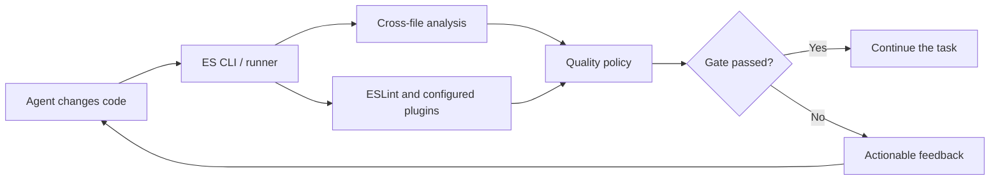
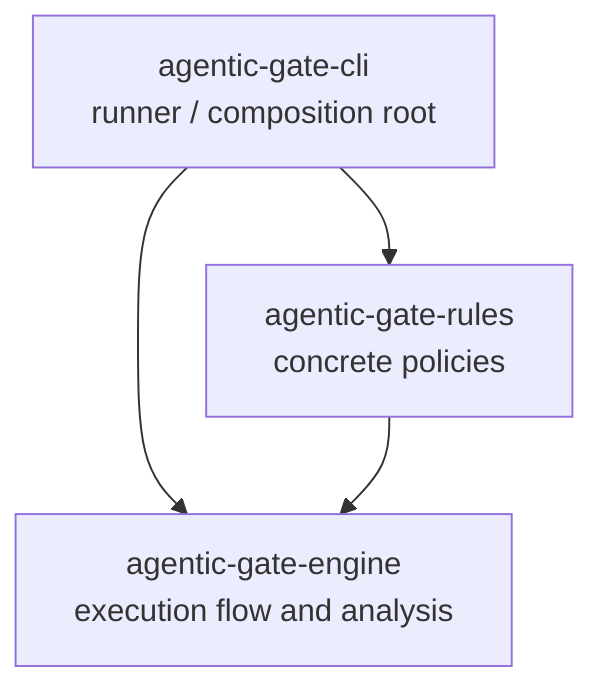
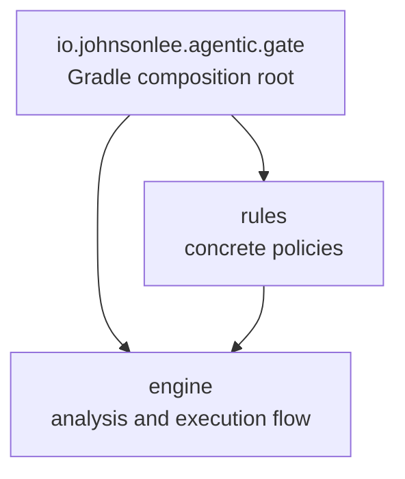

# Agentic Gate

**Continuous Code Quality for Coding Agents**

Turn project-wide analysis, linting, complexity checks, and tests into a quality loop that coding agents can understand and repair.

[](#project-status)
[](LICENSE)

**English** · [中文](README.zh.md)

> [!IMPORTANT]
> Agentic Gate is pre-alpha. The ES CLI/runner and the initial JVM engine, rules, and Gradle plugin are available for local development, but there is no published release yet.

## Why Agentic Gate?

Coding agents shorten the time between an idea and a code change. Quality tools still tend to sit outside that loop: they report a problem, but they do not decide whether the agent should continue or explain the failure in a form the agent can immediately act on.

Agentic Gate is designed to connect existing quality tools to the agent's development loop. After a code change or compilation, it will validate the result, apply the project's quality policy, and send actionable failures back to the agent for repair.

> Agentic Gate is the control point between **code generated** and **code accepted**.

## One Gate, Three Responsibilities

| Check | Enforce | Feedback |
| :--- | :--- | :--- |
| Run linting, static analysis, complexity checks, tests, and project-defined validations. | Compare results with the project's quality policy and decide whether the agent may continue. | Turn failures into precise guidance that tells the agent what failed, where it failed, and what to fix. |

## The Quality Loop



The loop has four steps:

1. The agent changes code or completes a compilation.
2. Agentic Gate runs the checks configured for that project.
3. The quality policy either allows the agent to continue or blocks the current result.
4. A blocked result becomes repair-oriented feedback, and the agent tries again.

This puts validation next to the change that caused the failure, while the relevant code and task context are still fresh.

## Platform Integrations

Agentic Gate builds on the native analysis and build systems of each ecosystem instead of replacing them.

| Ecosystem | Integration | Status |
| --- | --- | :---: |
| JavaScript / TypeScript | Coordinate every configured ESLint plugin and add project-wide, cross-file analysis. | 🛠️ In Progress |
| Java / Kotlin | Enforce JVM quality rules through a Gradle plugin that triggers Agentic Gate after compilation. | 🛠️ In Progress |

The platform integrations differ, but the contract stays the same: **check, enforce, and return actionable violations**.

## ES Components

The ES implementation is split into three packages with one-way source dependencies:



| Package | Responsibility |
| --- | --- |
| [`agentic-gate-cli`](es/cli/) | Loads `gate.config.*` and the concrete rules package, injects those rules into the engine, formats results, and exposes the executable. |
| [`agentic-gate-rules`](es/rules/) | Defines native unit and global rules, assembles the Agentic Gate ESLint preset, and selects non-negotiable checks from [`eslint-plugin-unicorn`](https://github.com/sindresorhus/eslint-plugin-unicorn). |
| [`agentic-gate-engine`](es/engine/) | Controls source discovery, ESLint and project-wide analysis, execution order, gate decisions, and normalized `Violation` results through injected rule contracts. |

The runner is the composition root: it knows both the concrete rules and the engine. The engine owns the workflow and invokes injected rules without importing `agentic-gate-rules`. Package manifests define this architecture boundary, so it is not repeated as configurable layers in `gate.config.ts`.

The canonical workspace layering principles and blocking conditions are defined in [`AGENTS.md`](AGENTS.md#layered-architecture-gate). Self-gating starts from the root workspace manifest and analyzes the package graph in one run.

ESLint and Unicorn report patterns visible within an individual file. The engine combines those checks with module-graph and source-wide analysis, then exposes every failure through the same `Violation` model. The runner loads the project's existing `eslint.config.*` before applying the complete Agentic Gate ESLint preset as a blocking override. Runner-specific discovery configuration lives in `gate.config.ts`:

```ts
import type { AgenticGateConfig } from "agentic-gate-cli";

export default {
  eslint: { targets: ["src", "test"] },
  project: {
    files: "eslint-input",
    entries: "auto",
  },
} satisfies AgenticGateConfig;
```

`gate.config.ts` identifies source files and public entry points; it does not configure rule behavior, thresholds, exceptions, severities, or architecture layers. A check whose outcome can be negotiated through configuration is not a hard gate.

`eslint.targets` selects the paths passed to ESLint, and `eslint.configFile` may name one explicit `eslint.config.*` file. `project.files` accepts either `"eslint-input"` or an explicit array of source globs; `project.entries` accepts either `"auto"` or an explicit array of public entries. When no path is supplied, exactly one discovered `gate.config.*` file is allowed.

The rules package contains 12 native file-local rules and 32 non-negotiable Unicorn checks, plus project-wide policies for duplicate top-level statements, duplicate functions, duplicate constants within a module directory, extensionless non-directory imports, module-internal leaks, repeated template literal fragments, unused code, module dependency cycles, workspace package boundaries, workspace binary availability, and workspace dependency cycles. Native rules also reject wildcard re-exports so module interfaces cannot expand implicitly. Module and workspace graphs must remain DAGs; cycle violations include the resolved graph as a Mermaid flowchart.

In the ES gate, a named source file is a single-file interface. Relative references to concrete files include the actual source extension, while an extensionless relative reference always means a directory module. A directory becomes a module only when its `index.{ts,tsx,js,jsx,mjs,cjs}` fronts additional implementation files or child modules. Outside callers import that directory; extensionless file imports, explicit index imports, implementation-file imports, nested-module traversal, and index-only wrapper directories are violations. Package exports target real module indexes. Rule definitions live under [`src/rules/unit`](es/rules/src/rules/unit/) for one-file ESLint checks and [`src/rules/global`](es/rules/src/rules/global/) for project-wide checks; TypeDoc renders their source comments as the ES gate's developer site.

## JVM Components

The JVM implementation follows the same one-way project structure:



Apply the plugin once. It collects the Java and Kotlin compiler inputs and automatically runs the hard gate after compilation completes:

```kotlin
plugins {
    id("io.johnsonlee.agentic.gate") version "0.1.0"
}
```

The JVM gate currently blocks empty catch clauses, duplicate complete statements and functions, unused local variables and locally controlled parameters, hardcoded string comparisons, wildcard imports, unreviewable string literals, and magic numbers. The same rules run through the standalone engine for Java/Kotlin projects and through native variant lint tasks in Android projects. Every violation includes its source range and an actionable repair instruction. The Gradle plugin has no rule settings or severity switches.

## Repository Layout

```text
.
├── es/
│   ├── cli/                    # Runner, composition root, output, and executable
│   ├── rules/                  # Native rules and curated third-party hard gates
│   └── engine/                 # Contracts, analyzers, and execution flow
├── jvm/
│   ├── engine/                 # JVM analysis and execution flow
│   ├── rules/                  # JVM quality policies
│   └── gradle/                 # Gradle composition root and lifecycle plugin
├── examples/
│   ├── es/                     # End-to-end ES example
│   ├── java/                   # Gradle Java example
│   └── android/                # Native Android lint example
├── docs/                       # Generated aggregate developer documentation
├── tooling/
│   └── docs.ts                 # Developer documentation assembly tool
├── package.json                # Bun workspace and repository scripts
├── bun.lock                    # Reproducible JavaScript dependencies
├── settings.gradle.kts         # JVM module structure and repositories
└── build.gradle.kts            # Root Gradle lifecycle
```

The public ES result and feedback model lives in the engine [`contract`](es/engine/src/contract/) module. Runtime source lives under `es/` and `jvm/`, with tests kept beside the project they cover.

## Design Principles

- **Continuous by default** — validate while the agent is working, not only at the end of a pull request.
- **Ecosystem-native** — use native analyzers where their scope fits and add runner-level analysis for relationships across files.
- **Non-negotiable** — every built-in violation blocks the agent, without configurable thresholds, severities, or exceptions.
- **Repair-oriented** — describe failures so an agent can locate the cause and make the next change.
- **Extensible** — make new checks and platform integrations part of the same quality loop.

## Project Status

Agentic Gate is currently **pre-alpha**. The repository contains the ES project runner, built-in ESLint and project-wide checks, the JVM gate engine and hard rules, and a Gradle plugin with tested Java, Kotlin, and Android post-compilation enforcement. The packages have not been published. APIs, configuration, and package coordinates may change before the first stable release.

## Development

The ES workspace uses [Bun](https://bun.sh/) for dependency management, scripts, tests, and builds:

```sh
bun install
bun run build
bun install --frozen-lockfile
bun run gate:self
bun run check
bun run docs
bun run check:unused
bun run example:es
bun run example:java
bun run example:android
```

`bun run check` verifies the ES CLI, its ESLint rules, multi-file runner fixtures, built-artifact smoke test, JVM checks, Gradle TestKit fixtures, and local Maven publications. `bun run check:unused` is repository maintenance rather than the public CLI interface.

Developer documentation stays with the implementation that defines it. A repository-level TypeDoc configuration renders TSDoc from all three ES projects into `es/rules/build/docs`; `docs.manifest.json` declares that ES site to the root assembler. `bun run docs` generates every implemented gate and creates the shared portal at `docs/index.html`, with each complete site copied under `docs/gates/`.

JVM source uses KDoc, each Gradle module uses Dokka to produce its standalone HTML site, and each module registers that output with its own `docs.manifest.json`. The root assembler only consumes static sites, so Kotlin documentation does not couple TypeDoc and Dokka or merge their assets.

## Initial Roadmap

- [x] Define the public [gate result and violation/remediation contract](es/engine/src/contract/)
- [x] Build the initial [ES CLI/runner](es/cli/) and cross-file unused-code gate
- [x] Split ES into the [runner](es/cli/), [rules](es/rules/), and [engine](es/engine/) projects
- [ ] Add more cross-file checks and stable project-discovery policies
- [x] Build the [JVM gate engine](jvm/engine/)
- [x] Build the [Gradle plugin and post-compilation trigger](jvm/gradle/)
- [x] Add executable ES, Java, and Android [end-to-end examples](examples/)

This roadmap is an initial direction and will evolve as the first integrations reveal what agents need from a useful quality gate.

## Get Involved

Agentic Gate is at the stage where early feedback can shape its public interfaces and workflow. If you work with coding agents, open an issue and tell us:

- which agent, language, and build system you use;
- which checks should be enforced;
- when the gate should run; and
- what feedback would help the agent repair a failure.

Experience with ESLint, JVM analysis, or Gradle is especially welcome. Start a conversation in [GitHub Issues](https://github.com/johnsonlee/agentic-gate/issues).

## License

Agentic Gate is licensed under the [Apache License 2.0](LICENSE).
