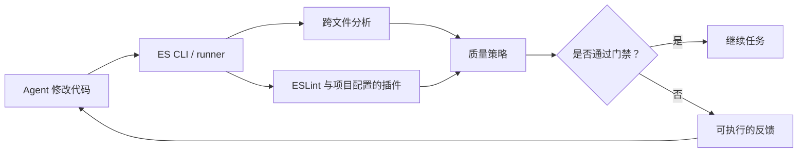
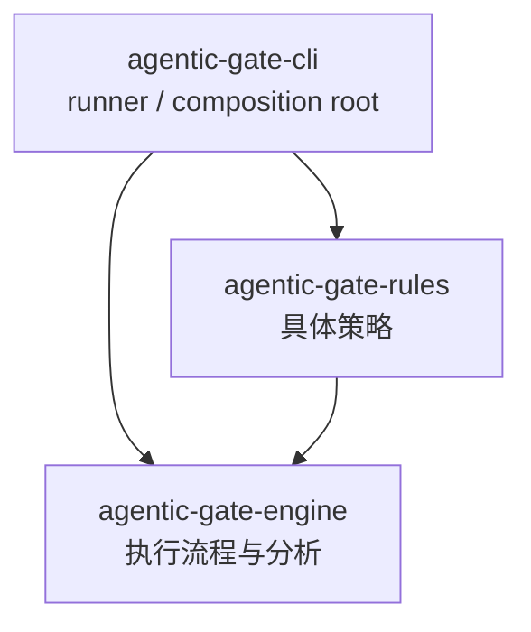
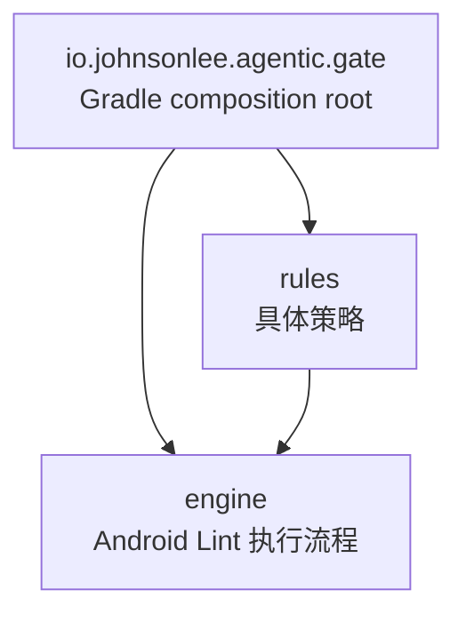

# Agentic Gate

**面向编程 Agent 的持续代码质量保障**

将项目级分析、lint、复杂度检查和测试转化为编程 Agent 能够理解并主动修复的质量闭环。

[](#项目状态)
[](LICENSE)

[English](README.md) · **中文**

> [!IMPORTANT]
> Agentic Gate 目前处于 pre-alpha 阶段。ES CLI/runner 以及首版 JVM engine、rules 与 Gradle 插件已经可以在本地开发和验证，但尚未发布可安装版本。

## 为什么需要 Agentic Gate？

编程 Agent 缩短了从想法到代码修改的时间，但质量工具通常仍然位于这个循环之外：它们可以报告问题，却无法决定 Agent 是否应该继续，也不会将失败结果解释成 Agent 能够立即执行的修复指引。

Agentic Gate 旨在将现有质量工具接入 Agent 的开发循环。代码发生修改或完成编译后，它会验证结果、执行项目的质量策略，并将可执行的失败反馈返回给 Agent 修复。

> Agentic Gate 是从**生成代码**到**接受代码**之间的控制节点。

## 一个门禁，三项职责

| 检查（Check） | 执行门禁（Enforce） | 反馈（Feedback） |
| :--- | :--- | :--- |
| 执行 lint、静态分析、复杂度检查、测试以及项目定义的其他验证。 | 根据项目的质量策略评估结果，决定是否允许 Agent 继续。 | 将失败转换成准确的修复指引，告诉 Agent 哪里失败、为什么失败以及需要修改什么。 |

## 质量闭环



质量闭环包含四个步骤：

1. Agent 修改代码或完成一次编译。
2. Agentic Gate 执行为当前项目配置的检查。
3. 质量策略决定允许 Agent 继续，还是阻止当前结果通过。
4. 被阻止的结果转换成面向修复的反馈，Agent 修改后再次验证。

这一过程让验证紧跟导致失败的代码修改，此时相关代码和任务上下文仍然完整。

## 平台集成

Agentic Gate 基于各技术生态原生的分析与构建体系扩展，而不是另建一套平行工具链。

| 技术生态 | 技术基础 | 集成方式 | 状态 |
| --- | --- | --- | :---: |
| JavaScript / TypeScript | ES CLI/runner + [ESLint](https://eslint.org/) 插件 | 编排项目配置的全部 ESLint 插件，并补充项目级跨文件分析。 | 🛠️ 进行中 |
| Java / Kotlin | Android Lint + UAST | 提供自定义 lint rules 和 Gradle 插件，在编译完成后自动触发 Agentic Gate。 | 🛠️ 进行中 |

不同平台采用不同的集成方式，但遵循同一个约定：**检查、执行门禁、返回可执行的违规项**。

## ES 组件

ES 实现拆分为三个源码依赖单向的 package：



| Package | 职责 |
| --- | --- |
| [`agentic-gate-cli`](es/cli/) | 加载 `gate.config.*` 和具体 rules package，将 rules 注入 engine，格式化结果并提供可执行程序。 |
| [`agentic-gate-rules`](es/rules/) | 定义原生 unit/global rules，组装 Agentic Gate ESLint preset，并从 [`eslint-plugin-unicorn`](https://github.com/sindresorhus/eslint-plugin-unicorn) 中选择不可协商的检查。 |
| [`agentic-gate-engine`](es/engine/) | 通过注入的 rule contract 控制源码发现、ESLint 与项目级分析、执行顺序、门禁决策和统一的 `Violation` 结果。 |

runner 是 composition root：它同时知道具体 rules 和 engine。engine 负责控制流程并调用注入的 rules，但不 import `agentic-gate-rules`。package manifest 已经定义了这一架构边界，因此无需在 `gate.config.ts` 中再次声明可配置的层次。

workspace 分层原则和阻断条件的唯一规范位于 [`AGENTS.md`](AGENTS.md#layered-architecture-gate)。自门禁从根 workspace manifest 开始，在一次运行中分析完整的 package graph。

ESLint 和 Unicorn 报告单个文件内可见的代码模式。engine 将这些检查与模块图、全项目源码分析组合起来，再通过统一的 `Violation` 模型暴露所有失败。runner 会先加载项目现有的 `eslint.config.*`，再把完整的 Agentic Gate ESLint preset 作为阻断型 override 应用。runner 的源码发现配置位于 `gate.config.ts`：

```ts
import type { AgenticGateConfig } from "agentic-gate-cli";

export default {
  eslint: { targets: ["src", "test"] },
  project: {
    files: "eslint-input",
    entries: "auto",
  },
} satisfies AgenticGateConfig;
```

`gate.config.ts` 只负责标识源码和公共入口，不允许配置 rule 行为、阈值、例外、严重级别或架构层次。能够通过配置协商结果的检查不是 hard gate。

rules package 包含 10 条原生单文件规则、32 条不可协商的 Unicorn 检查，以及项目级的重复顶层 statement、重复 function、模块目录内重复常量、无后缀非目录 import、模块内部实现泄漏、重复模板字符串静态片段、未使用代码、模块依赖环、workspace package 边界、workspace binary 可用性和 workspace 依赖环策略。原生规则还会禁止 wildcard re-export，避免模块接口在无审查的情况下自动扩张。模块图与 workspace 图都必须保持为 DAG；发现依赖环时，violation 会附上实际解析出的 Mermaid flowchart。

在 ES gate 中，具名源码文件本身就是单文件接口。相对引用具体文件时必须写出真实源码后缀；省略后缀的相对引用只表示目录模块。当 `index.{ts,tsx,js,jsx,mjs,cjs}` 为同目录中的其它实现文件或子模块提供接口时，该目录才构成模块。外部调用方引用模块目录；省略后缀的文件 import、显式引用 index、直接引用实现文件、穿透模块访问子模块，以及只有 index 的空壳目录都会构成违规。package exports 只能指向真正模块的 index。单文件 ESLint 检查统一放在 [`src/rules/unit`](es/rules/src/rules/unit/)，项目级检查统一放在 [`src/rules/global`](es/rules/src/rules/global/)，TypeDoc 直接将这些源码注释渲染为 ES gate 的开发文档站点。

## JVM 组件

JVM 实现采用相同的单向工程结构：



应用一次插件即可。插件会收集 Java 与 Kotlin 编译器输入，并在编译完成后自动执行 hard gate：

```kotlin
plugins {
    id("io.johnsonlee.agentic.gate") version "0.1.0"
}
```

首条 `AgenticGateSilentCatch` rule 会阻止能够确定为空的 Java 与 Kotlin catch 子句。每个 violation 都包含源码范围与可执行的修复指引。Gradle 插件不提供 rule 参数或严重级别开关。

## 仓库结构

```text
.
├── es/
│   ├── cli/                    # Runner、composition root、输出与可执行程序
│   ├── rules/                  # 原生 rules 与第三方 hard gates
│   └── engine/                 # Contract、分析器与执行流程
├── jvm/
│   ├── engine/                 # 基于 Android Lint 的 JVM lint 引擎
│   ├── rules/                  # JVM 质量策略
│   └── gradle/                 # Gradle composition root 与生命周期插件
├── examples/
│   ├── es-runner/              # ES CLI 端到端示例
│   └── android-gradle/         # Android + Gradle 端到端示例
├── docs/                       # 生成的聚合开发文档
├── tooling/
│   └── docs.ts                 # 开发文档装配工具
├── package.json                # Bun workspace 与仓库脚本
├── bun.lock                    # 可复现的 JavaScript 依赖
├── settings.gradle.kts         # JVM 模块结构与仓库配置
└── build.gradle.kts            # Gradle 根生命周期
```

公开的 ES 结果与反馈模型位于 engine 的 [`contract`](es/engine/src/contract/) 模块。运行时源码分别位于 `es/` 和 `jvm/`，测试与其覆盖的工程放在一起。

## 设计原则

- **持续验证** — 在 Agent 工作过程中完成验证，而不是等到 Pull Request 的最后阶段。
- **贴合技术生态** — 在适合的范围内复用生态原生分析器，并由 runner 补充跨文件关系分析。
- **不可协商** — 每个内置 violation 都会阻止 Agent，不提供可配置的阈值、严重级别或例外。
- **面向修复** — 描述失败的具体原因，让 Agent 能够定位问题并完成下一次修改。
- **易于扩展** — 让新的检查与平台集成都能复用同一套质量闭环。

## 项目状态

Agentic Gate 目前处于 **pre-alpha** 阶段。仓库已经包含 ES 项目 runner、内置 ESLint 与项目级检查、基于 Android Lint 的 JVM engine、首条 JVM rule，以及经过编译后门禁测试的 Gradle 插件。这些 package 尚未发布。在首个稳定版本发布前，API、配置方式和包坐标都可能发生变化。

## 开发

ES workspace 使用 [Bun](https://bun.sh/) 管理依赖、脚本、测试和构建：

```sh
bun install
bun run check
bun run docs
bun run check:unused
bun run example:runner
```

`bun run check` 会验证 ES CLI、ESLint 规则、多文件 runner fixture、构建产物 smoke test、JVM checks、Gradle TestKit fixture 和本地 Maven publications。`bun run check:unused` 只用于仓库自身维护，不是公开 CLI 接口。

开发文档与定义它的实现放在一起。ES rules 工程使用 TSDoc 注释和 TypeDoc 生成 `es/rules/build/docs`，并通过 `docs.manifest.json` 将这个站点声明给根装配器。`bun run docs` 会生成所有已经实现的 gate 文档，并在 `docs/index.html` 创建统一入口，各个完整站点分别复制到 `docs/gates/` 下。

JVM 源码使用 KDoc，各 Gradle module 通过 Dokka 生成独立 HTML 站点，再用自己的 `docs.manifest.json` 注册输出目录。根装配器只消费静态站点，因此 Kotlin 文档无需耦合 TypeDoc 与 Dokka，也不会混合两者的资源文件。

## 初始路线图

- [x] 定义公开的[门禁结果与违规项/修复反馈契约](es/engine/src/contract/)
- [x] 实现首个 [ES CLI/runner](es/cli/) 与跨文件 unused-code 门禁
- [x] 将 ES 拆分为 [runner](es/cli/)、[rules](es/rules/) 和 [engine](es/engine/) 三个工程
- [ ] 增加更多跨文件检查与稳定的项目发现策略
- [x] 实现[基于 Android Lint 的 JVM lint 引擎](jvm/engine/)
- [x] 实现 [Gradle 插件和编译后触发机制](jvm/gradle/)
- [ ] 增加特定 Agent 的集成指南与[端到端示例](examples/)

这份路线图代表初步方向。随着首批集成逐渐明确 Agent 对质量门禁的实际需求，它也会继续调整。

## 参与项目

Agentic Gate 正处于公共接口和工作方式仍可被早期反馈塑造的阶段。如果你正在使用编程 Agent，欢迎提交 Issue 并告诉我们：

- 你使用的 Agent、编程语言和构建系统；
- 你希望执行哪些质量检查；
- 质量门禁应该在什么时候运行；
- 什么样的反馈能够帮助 Agent 修复失败。

我们也特别欢迎 ESLint、Android Lint、UAST 或 Gradle 方面的实践经验。请通过 [GitHub Issues](https://github.com/johnsonlee/agentic-gate/issues) 发起讨论。

## 许可证

Agentic Gate 采用 [Apache License 2.0](LICENSE) 许可证。
